<p align="center">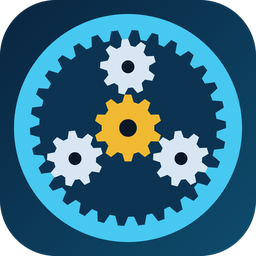</p>

# Autodesk Fusion 360 - Parametric Planetary Gearbox Generator
### *Parametrik Planet Redüktör Tasarımcısı (Spur & Herringbone / Balıksırtı)*

[](https://www.autodesk.com/products/fusion-360)
[](https://www.python.org/)
[](LICENSE)
[](CHANGELOG.md)
[]()

[🇬🇧 English](#-english) | [🇹🇷 Türkçe](#-türkçe)

---

## 📸 Gallery / Galeri

*Generated models, imported into Fusion 360 — complete, with a see-through housing and in section.*  
*Üretilen modeller Fusion 360'ta — tam hali, saydam gövdeyle ve kesitte.*

| Complete / Tam | See-through / Saydam gövde | Section / Kesit |
|:---:|:---:|:---:|
| 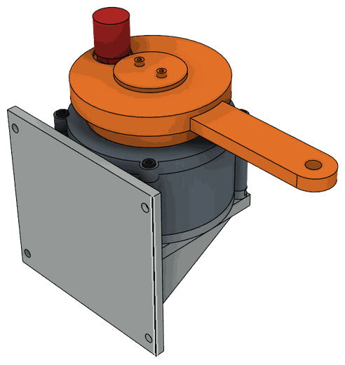 | 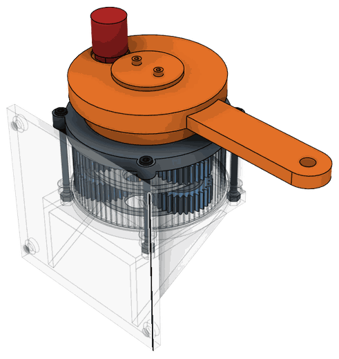 | 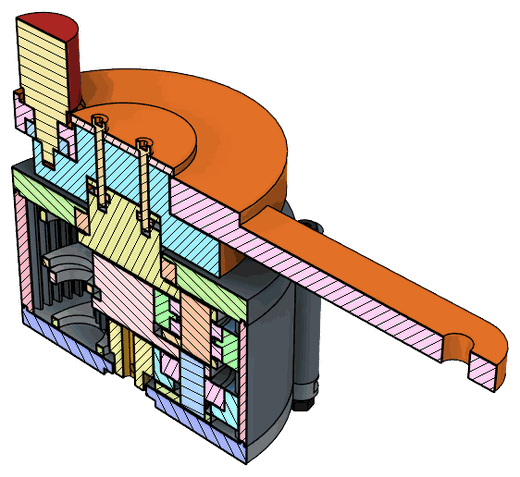 |
| **Standard — arm output, release plunger, side bracket** | *Standart — kol çıkışı, boşa alma pimi, yan braket* | |
| 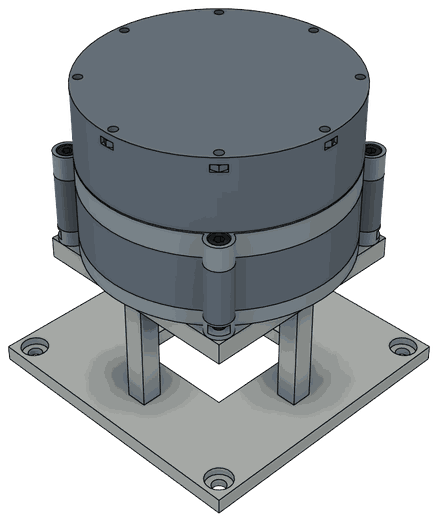 | 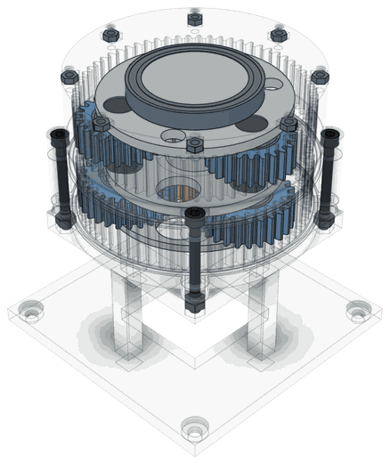 | 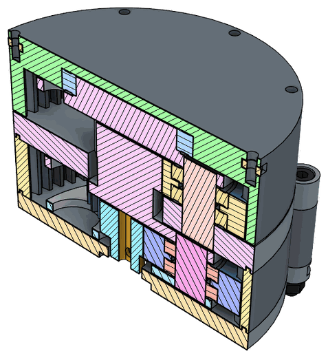 |
| **Rotating housing — drum flange, base mount** | *Dönen gövde — tambur flanşı, taban montajı* | |
| 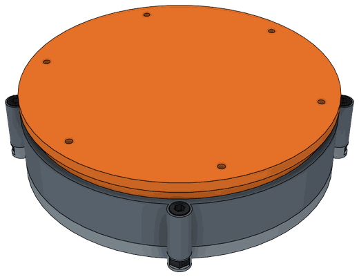 | 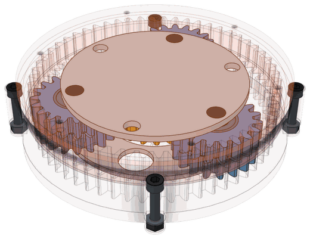 | 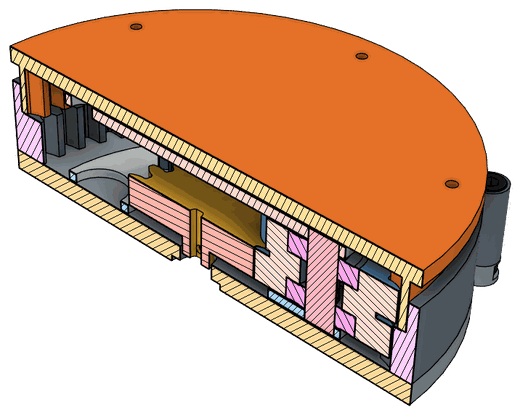 |
| **Wolfrom 100:1 — stepped planets, self-locking** | *Wolfrom 100:1 — kademeli planet, kendiliğinden kilitli* | |
| 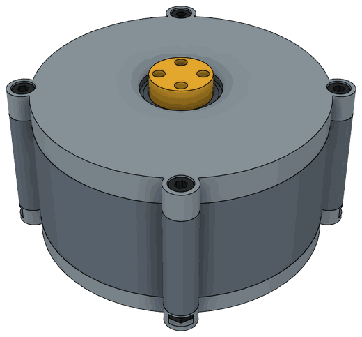 | 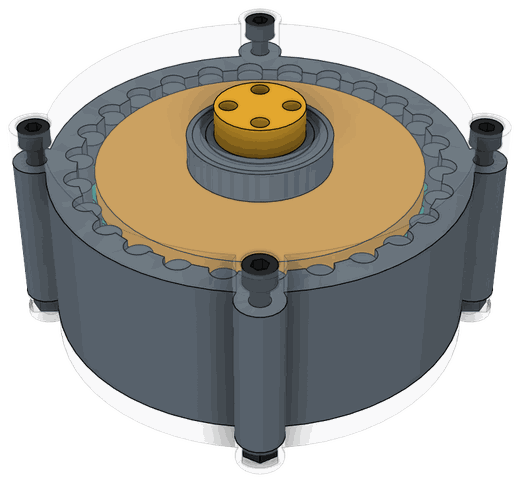 | 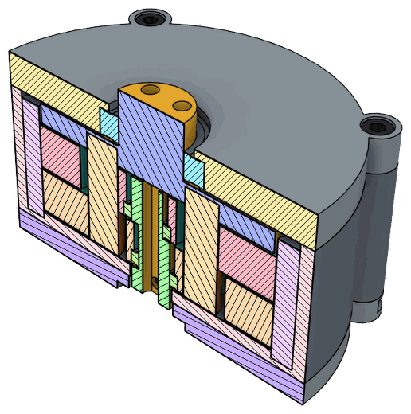 |
| **Cycloidal 25:1 — two discs, steel ring pins** | *Sikloidal 25:1 — iki disk, çelik halka pimleri* | |

# 🇬🇧 English

## Overview
**Planetary Gearbox Generator** is a professional Autodesk Fusion 360 Add-In designed to automatically synthesize, calculate, and 3D-model ready-to-manufacture, multi-stage planetary gearboxes. 

Simply specify your **motor shaft diameter**, **target reduction/torque ratio**, and **number of stages**, and the script will synthesize the optimal gear train kinematics and model the complete 3D assembly directly inside Fusion 360.

It also runs **without Fusion 360** as a desktop app on an OpenCascade kernel, with an engineering engine that sizes
the gearbox from the load, checks every part, and exports STEP, STL, a print-ready 3MF and an HTML report.

**Arrangements:** standard (carrier output), rotating housing (drum), speed-up, **Wolfrom** (50–500:1 in one stage,
often self-locking) and **cycloidal** (6–60:1, very stiff). **Outputs:** flange, printed / steel shaft, arm, drum face,
drum arm, winch drum — every arm optionally with a **spring index plunger release** (GN 617.1). **Mounting:** side
bracket, base stand or panel plate for every type. **Expert mode:** tooth temperature (VDI 2736 structure), load-cycle
life, wear and creep.

---

## 🌟 Key Features & Engineering Capabilities

1. **Smart Kinematic Synthesis Engine:**
   - Automatically satisfies the **coaxiality condition**:
     $$Z_{\text{ring}} = Z_{\text{sun}} + 2 \cdot Z_{\text{planet}}$$
   - Enforces the **equal planet spacing assembly condition**:
     $$(Z_{\text{sun}} + Z_{\text{ring}}) \pmod N = 0$$
   - Evaluates adjacent planet tip-to-tip clearance to prevent physical collisions.

2. **Herringbone (Double Helical) & Spur Gears:**
   - **Herringbone (Balıksırtı):** Opposing helix angles cancel axial thrust forces completely, offering smooth, quiet, and high-torque transmission—ideal for 3D printed and CNC-machined gearboxes.
   - **High-Performance Adaptive Spline:** Involute profiles are modeled using smooth closed `SketchFittedSplines` for 10–30× faster CAD regeneration without locking up Fusion 360.

3. **Multi-Stage Power Transmission:**
   - Supports **1 to 5 stages** (ratios from 3:1 up to ~50000:1), or an **automatic** stage count.
   - Generates unified continuous ring gear housings with inter-stage carrier-to-sun couplings.

4. **Bearings & Pin Shaft Library:**
   - Standard ball bearing presets: `688ZZ`, `608ZZ`, `684ZZ`, `623ZZ`, `MR105`, `MR117`, `MR128`.
   - Bearingless option: Direct steel pins or bronze bushings with custom diameters.

5. **Motor Interface Presets & Shaft Profiles:**
   - Standard flange mounting: **NEMA 17, NEMA 23, NEMA 34, 775 DC Motor, 540/550 RC Motors, or Custom**.
   - Shaft bore geometries: **Round (Press-fit/Setscrew), D-Cut (Single Flat), Double D-Cut, and Keyway (DIN 6885)**.

6. **Manufacturing Presets & Backlash Management:**
   - Pre-configured clearance offsets for **FDM 3D Printing (0.22mm)**, **SLA Resin (0.12mm)**, and **CNC Metal Milling (0.05mm with high-precision curve generation)**.

7. **Modern Dual-Language Web UI:**
   - Built-in live calculation panel, interactive SVG modal diagrams, and one-click **TR / EN language switching**.

---

## 🚀 Installation & Usage in Fusion 360

### Step 1: Copy to Fusion 360 Add-Ins Folder
Open the Fusion 360 Add-Ins directory:
- **Windows:** Press `Win + R`, paste the following and press Enter:
  ```text
  %appdata%\Autodesk\Autodesk Fusion 360\API\AddIns
  ```
- **macOS:**
  ```text
  ~/Library/Application Support/Autodesk/Autodesk Fusion 360/API/AddIns
  ```
Clone or copy this repository folder into that directory:
```bash
cd "%appdata%\Autodesk\Autodesk Fusion 360\API\AddIns"
git clone https://github.com/okanyyurt/Fusion360_Planetary_Gearbox_Generator.git PlanetaryGearboxGenerator
```

### Step 2: Install the CAD engine (once)
Run `Baslat_Standalone.bat` in the add-in folder once: it finds or installs a Python with OpenCascade (`cadquery-ocp-novtk`). The add-in uses this engine for the geometry and imports the result into Fusion 360 as a STEP assembly (components, colors, bearings, pins and bolts).

### Step 3: Run in Autodesk Fusion 360
1. Launch **Autodesk Fusion 360**.
2. Go to **UTILITIES** > **Scripts and Add-Ins** (`Shift + S`).
3. Under the **Add-Ins** tab, find **PlanetaryGearboxGenerator**.
4. Select it and click **Run**.
5. The dark-themed control palette will appear. Configure your parameters and click **"🚀 Start 3D Generation in Fusion 360"**!

---

## 🖥️ Standalone Mode (no Fusion 360 required)

The same UI also runs as a desktop app on an **OpenCascade** (OCP) kernel with a full engineering engine:

- **Automatic sizing** — *Automatic* (smallest housing that fits the chosen bearings and meets the strength
  targets), *Max. outer diameter* (strongest design within a size) or *Manual module*. Bearings can be
  chosen automatically per stage (highest capacity that fits the planet).
- **Engineering checks per stage** — tooth root bending (Lewis + ISO 6336-3 factors), contact stress (Hertz),
  planet bearing L10h and static safety, pin bending, sun core torsion, output torsion; efficiency, output
  torque/speed, continuous torque capacity and the limiting element. Material database (PLA, PETG, ABS/ASA,
  nylon, PA-CF, PC, resin, POM, aluminium, steel) with design values for printed parts.
- **Correct gear geometry** — backlash = total backlash per mesh, interference-free tip radii, root fillets,
  planets phased to mesh, correct herringbone hands, herringbone ring split at the apex planes.
- **Print-ready design** — cage carrier (two flat plates + ISO 8734 steel pins, next sun integrated, no
  supports), flush planet bearings (single/dual) with printed spacers, output flange on a thin-section
  bearing (or printed / steel D-shaft), centering spigots, counterbored motor screws, captive tie-rod nuts,
  standard bolt lengths with automatic cover counterbore. The classic single-plate carrier with circlips is
  still available.
- **Exports** — STEP assembly (named, colored, instances; includes bearings, pins and bolts), print-oriented
  STL per printed part, HTML engineering report (checks, BOM, print settings, assembly steps), parts list.
- **Output options** — flange hub, printed or steel D-shaft, or a lever **arm** (flat or round, with tip
  load) on a double-D lock; thin-section output bearings up to 100 mm bore (6820), chosen automatically from
  the torque or by hand, with a suggestion when the chosen hub is too weak.
- **Automatic planet count** — each stage gets the most planets that fit (more planets carry more torque; the
  most loaded last stage usually gets the most). A fixed count that cannot fit the stage ratio is explained.
- **Captive nuts at the output** — the flange face and the arm hub take M3 screws into side-loaded hex nut
  pockets (like the housing tie rods); heat-set inserts remain an option. The nut-pocket layer is checked in
  torsion. Carrier plates are full disks with round lightening holes (no notches at arm junctions).
- **Requirement solver** — enter motor speed/torque, required output speed and torque, max. diameter and
  length (incl. the motor body) and your printer (e.g. *Creality K1 Max*): the engine derives the ratio and
  stages — for steppers it raises the ratio as far as the given space can carry the full motor torque —, checks
  the motor (incl. motor shaft), sizes the output arm, and searches face width and material for the smallest
  (or, with *strongest*, the space-filling) design that meets the targets — or tells you how close it gets and why.
- **✨ AI assistant (Google Gemini, optional)** — describe the gearbox in plain words; the assistant calls the
  requirement solver and the design engine as tools (it never invents numbers), compares options and offers
  the result as a card with *Apply to form* / *Apply and generate 3D*. Enter your Gemini API key under
  ⚙ Settings (stored encrypted with Windows DPAPI, sent only to Google's Gemini endpoint); *Automatic* picks
  the strongest model available to your key. Works in the desktop app and in the Fusion 360 palette.

```bash
Baslat_Standalone.bat                      # Windows: finds a Python with OCP + pywebview, offers to install them
python -m standalone                       # desktop window (pywebview / WebView2)
python -m standalone serve                 # same UI in a regular browser: http://127.0.0.1:8765
python -m standalone build --ratio 25 --stages 2 --herringbone -o out   # headless STEP + STL
python tests/test_standalone.py            # design + geometry tests (valid solids, no interference/clashes)
python tests/test_requirements.py         # requirement solver
python tests/test_ai.py                   # AI assistant against a fake Gemini server (no key needed)
```
Requirements: Python 3.11–3.14, `pip install -r requirements-standalone.txt` (`cadquery-ocp-novtk`, `pywebview`).
Paths with non-ASCII characters (e.g. `C:\Users\Okan Yeşilyurt\OneDrive\Belgeler`) are supported.

### What's new in 2.9.0
Single helical teeth and high contact ratio spur (HCR) as third and fourth tooth types, the release plunger also for
flange outputs (a free flange disc). 2.8.0: Wolfrom and cycloidal arrangements, a spring index plunger release for every arm output, mounting brackets for every
gearbox type (side / base stand / panel), expert mode (tooth temperature, cycle life, wear, creep). Full history:
**[CHANGELOG.md](CHANGELOG.md)**.

---

## 📁 Repository Structure

```
PlanetaryGearboxGenerator/
├── PlanetaryGearboxGenerator.manifest    # Fusion 360 Add-In descriptor
├── PlanetaryGearboxGenerator.py          # Fusion 360 add-in: palette bridge, STEP import
├── fusion_kinematics.py                  # Fusion 360 joints / motion links of the imported assembly
├── Baslat_Standalone.bat                 # Standalone launcher (Windows)
├── requirements-standalone.txt           # cadquery-ocp-novtk, pywebview
├── CHANGELOG.md                          # Version history (EN / TR)
├── test_generator.py                     # Kinematics & profile geometry verification suite (legacy)
├── core/                                 # Engineering engine (no CAD dependency)
│   ├── design.py                         # Automatic sizing: modules, tooth sets, bearings, outputs, layout
│   ├── engineering.py                    # Strength (ISO 6336 based), K_Hβ, bearings, torsion, arms, release pin
│   ├── expert.py                         # Expert mode: tooth temperature, cycle life, wear, creep
│   ├── wolfrom.py / cycloid.py           # Wolfrom and cycloidal arrangements (search + analysis)
│   ├── requirements.py                   # Requirement solver (speed / torque / space / printer → design)
│   ├── gear_geometry.py / tooth_profile.py   # Involute geometry, profile shift, contact ratios
│   ├── layout.py                         # Axial layout, brackets, release pin heights
│   ├── materials.py / hardware.py        # Material design values, dowels, bolts, index plungers
│   ├── kinematics.py                     # Tooth synthesis engine & assembly rule validator
│   └── bearing_catalog.py / motor_catalog.py / circlip_catalog.py
├── occ_cad/                              # OpenCascade CAD: kernel, profiles, parts, assembly, export, report
│   ├── wolfrom_cad.py / cycloid_cad.py   # CAD of the special arrangements
│   ├── calibration.py                    # Printable calibration coupon (bearing seats, pins, backlash)
│   └── print3mf.py                       # Print-ready 3MF (plates, per-part settings, slicer profiles)
├── standalone/                           # Desktop app (pywebview), HTTP server, CLI, Fusion bridge, AI assistant
├── resources/slicer_profiles/            # Creality K1 family printer / process / filament profiles
├── tools/make_slicer_profiles.py         # Rebuilds the slicer profiles with a local OrcaSlicer
├── tests/                                # test_standalone.py, test_requirements.py, test_ai.py
└── ui/                                   # HTML5 UI (bilingual), app.js, i18n.js, viewer.js (three.js), guide.js (user guide), assets/
```

---

# 🇹🇷 Türkçe

## Genel Bakış
**Parametrik Planet Redüktör Tasarımcısı**, Autodesk Fusion 360 içerisinde **motor şaftı, hedef redüksiyon/tork oranı, kademe sayısı, yataklama tipi ve balıksırtı (herringbone) dişli geometrisini** alarak üretime hazır, tam montajlı planet redüktörler modelleyen profesyonel bir CAD eklentisidir.

---

**Kısaca:** Fusion 360 olmadan da (OpenCascade çekirdekli masaüstü uygulaması) çalışır; redüktörü yükten
boyutlandırır, her parçayı hesapla kontrol eder; STEP, STL, baskıya hazır 3MF ve HTML rapor üretir. **Düzenler:**
standart (taşıyıcı çıkışı), dönen gövde (tambur), hız artırıcı, **Wolfrom** (tek kademede 50–500:1, çoğu kendiliğinden
kilitli) ve **sikloidal** (6–60:1, çok rijit). **Çıkışlar:** flanş, baskı / çelik mil, kol, tambur yüzü, tambur kolu,
vinç tamburu — her kolda isteğe bağlı **yaylı indeks pimiyle boşa alma** (GN 617.1). **Montaj:** her tipte yan braket,
ayaklı taban veya panel plakası. **Uzman modu:** diş sıcaklığı (VDI 2736 yapısında), çevrim ömrü, aşınma, sünme.

## 🌟 Özellikler ve Mühendislik Kabiliyetleri

1. **Akıllı Kinematik Sentez Motoru:**
   - **Eş eksenlilik şartını** otomatik hesaplar:
     $$Z_{\text{çember}} = Z_{\text{güneş}} + 2 \cdot Z_{\text{planet}}$$
   - **Eşit açılı planet montaj kuralını** denetler:
     $$(Z_{\text{güneş}} + Z_{\text{çember}}) \pmod N = 0$$
   - Planet dişlilerin birbirine temas etmesini önleyen emniyet boşluğunu (clearance) kontrol eder.

2. **Balıksırtı (Herringbone / Çavuş) ve Düz Dişli:**
   - **Balıksırtı:** V şekilli zıt helis açıları ile eksenel kuvvetleri tamamen sıfırlar; sessiz, yüksek torklu ve 3D baskıda eksenel kaymayı önleyen ideal yapı sunar.
   - **Performans Odaklı Adaptif Spline:** Diş profilleri tek parça kapalı spline olarak çizilir, Fusion 360'ın donmasını engeller ve 10–30 kat daha hızlı çizim yapar.

3. **Çok Kademeli (Multi-Stage) Güç Aktarımı:**
   - **1–5 kademe** desteği (3:1'den ~50000:1'e kadar oranlar) veya **otomatik** kademe sayısı.
   - Kademeler arası taşıyıcı-güneş dişli akupleleri ve yekpare ortak çember dişli gövdesi sentezler.

4. **Rulman ve Mil Kütüphanesi:**
   - Hazır bilyalı rulmanlar: `688ZZ`, `608ZZ`, `684ZZ`, `623ZZ`, `MR105`, `MR117`, `MR128`.
   - Rulmansız seçenek: Doğrudan çelik pim veya bronz burç çapı belirleme.

5. **Motor Arayüzü Şablonları:**
   - Motor flanşları: **NEMA 17, NEMA 23, NEMA 34, 775 DC Motor, 540/550 RC Motor veya Özel**.
   - Şaft delikleri: **Yuvarlak (Pres-geçme/Setskur), D-Şaft (Tek düzlük), Çift D-Şaft ve Kamalı (DIN 6885)**.

6. **3D Baskı / CNC Tolerans ve Backlash Yönetimi:**
   - **FDM 3D Yazıcı (0.22mm)**, **SLA Reçine (0.12mm)** ve **CNC Metal İşleme (0.05mm + yüksek hassasiyet)** için hazır tolerans profilleri.

7. **Modern İki Dilli Arayüz (TR / EN):**
   - Canlı kinematik hesaplama kartı, teknik SVG yardım şemaları ve tek tıkla **Türkçe / İngilizce** geçişi.

---

## 🚀 Kurulum ve Çalıştırma

### Adım 1: Eklenti Klasörünü Kopyalama
Fusion 360 Add-Ins klasörünü açın:
- **Windows:** `Win + R` tuşlarına basıp aşağıdaki adresi yapıştırın ve Enter'a basın:
  ```text
  %appdata%\Autodesk\Autodesk Fusion 360\API\AddIns
  ```
- **macOS:**
  ```text
  ~/Library/Application Support/Autodesk/Autodesk Fusion 360/API/AddIns
  ```

Bu depoyu bu dizin içerisine klonlayın veya kopyalayın:
```bash
cd "%appdata%\Autodesk\Autodesk Fusion 360\API\AddIns"
git clone https://github.com/okanyyurt/Fusion360_Planetary_Gearbox_Generator.git PlanetaryGearboxGenerator
```

### Adım 2: CAD motorunu kurma (bir kez)
Eklenti klasöründeki `Baslat_Standalone.bat` dosyasını bir kez çalıştırın: OpenCascade (`cadquery-ocp-novtk`) kurulu bir Python bulur veya kurar. Eklenti geometriyi bu motorla üretir ve sonucu Fusion 360'a STEP montajı olarak aktarır (bileşenler, renkler, rulman, pim ve cıvatalar dahil).

### Adım 3: Fusion 360 İçinde Çalıştırma
1. **Autodesk Fusion 360**'ı açın.
2. Üst menüden **UTILITIES (Araçlar)** > **Scripts and Add-Ins** (`Shift + S`) penceresini açın.
3. **Add-Ins** sekmesine geçin.
4. Listede **PlanetaryGearboxGenerator** eklentisini seçip **Run (Çalıştır)** butonuna tıklayın.
5. Açılan modern arayüzden parametrelerinizi seçip **"🚀 Fusion 360'ta 3D Çizimi Başlat"** butonuna basın.

---

## 🖥️ Bağımsız Çalışma (Fusion 360 gerekmez)

Aynı arayüz, **OpenCascade** (OCP) çekirdeği ve tam bir mühendislik motoruyla masaüstü uygulaması olarak da çalışır:

- **Otomatik boyutlandırma** — *Otomatik* (seçilen rulmanların sığdığı ve dayanım hedeflerini sağlayan en küçük
  gövde), *Maks. dış çap* (verilen çap içinde en dayanıklı tasarım) veya *Manuel modül*. Rulman her kademe için
  otomatik seçilebilir (planete sığan en yüksek kapasiteli rulman).
- **Kademe bazında mühendislik kontrolleri** — diş dibi eğilme (Lewis + ISO 6336-3 faktörleri), yüzey basıncı
  (Hertz), planet rulmanı L10h ve statik emniyet, pim eğilmesi, güneş çekirdeği ve çıkış burulması; verim, çıkış
  torku/devri, sürekli tork kapasitesi ve sınırlayan eleman. Baskı parçaları için tasarım değerleri içeren malzeme
  veritabanı (PLA, PETG, ABS/ASA, naylon, PA-CF, PC, reçine, POM, alüminyum, çelik).
- **Doğru diş geometrisi** — backlash = kavrama başına toplam boşluk, girişimsiz uç yarıçapları, kök radyüsleri,
  kavrama fazlı planetler, doğru balıksırtı yönleri, V tepe düzlemlerinden bölünen balıksırtı çember.
- **Baskıya hazır tasarım** — kafes taşıyıcı (iki düz plaka + ISO 8734 çelik pim, sonraki güneş gömülü, desteksiz
  baskı), yüzey hizasında tek/çift planet rulmanları ve baskı ara halkaları, ince kesit rulmanlı çıkış flanşı
  (veya baskı / çelik D-mil), merkezleme omuzları, havşalı motor vidaları, yandan takılan somun yuvaları, standart
  cıvata boyu + otomatik kapak havşası. Segmanlı klasik tek plaka taşıyıcı da seçilebilir.
- **Çıktılar** — STEP montajı (adlandırılmış, renkli, instance; rulman, pim ve cıvatalar dahil), baskı yönünde
  parça başına STL, HTML mühendislik raporu (kontroller, malzeme listesi, baskı ayarları, montaj talimatı), parça listesi.
- **Çıkış seçenekleri** — flanş göbeği, baskı veya çelik D-mil ya da çift-D kilitli **kol** (yassı/yuvarlak,
  uç yükü ile); 100 mm göbeğe kadar ince kesit çıkış rulmanları (6820), torka göre otomatik veya elle seçim,
  seçilen göbek zayıfsa hangi rulmanın gerektiği önerilir.
- **Otomatik planet sayısı** — her kademeye sığan en çok planet (daha çok planet daha çok tork taşır; en çok
  yüklenen son kademe genelde en çok planeti alır). Kademe oranına sığmayan sabit sayı seçilirse nedeni söylenir.
- **Çıkışta tutsak somun** — flanş yüzüne ve kol göbeğine giren M3 vidalar, gövde bağlantılarındaki gibi yandan
  takılan somun yuvalarına oturur; ısıl burç seçeneği de var. Somun yuvası katmanı burulmaya karşı kontrol edilir.
  Taşıyıcı plakalar yuvarlak hafifletme delikli tam disktir (kol birleşimlerinde çentik yok).
- **Gereksinim çözücü** — motor devri/torku, istenen çıkış devri ve torku, en fazla çap ve boy ile yazıcı
  modelinizi (örn. *Creality K1 Max*) girin: oranı ve kademe sayısını çıkarır — step motorda oranı verilen alanın
  tam motor torkunu taşıyabildiği yere kadar yükseltir —, motoru (motor mili dahil) kontrol eder, kolu boyutlandırır,
  diş genişliği ve malzemeyi tarayarak hedefleri sağlayan en küçük (*en güçlü* seçeneğinde alanı dolduran) tasarımı
  bulur — bulamazsa ne kadar yaklaşıldığını ve nedenini söyler.
- **✨ AI asistan (Google Gemini, isteğe bağlı)** — redüktörü kendi cümlelerinizle anlatın; asistan gereksinim
  çözücüyü ve tasarım motorunu araç olarak çağırır (rakam uydurmaz), seçenekleri karşılaştırır ve sonucu
  *Forma uygula* / *Uygula ve 3D oluştur* düğmeli bir kartla sunar. Gemini API anahtarını ⚙ Ayarlar'dan girin
  (Windows DPAPI ile şifreli saklanır, yalnızca Google'ın Gemini adresine gönderilir); *Otomatik* seçim
  anahtarınızla erişilebilen en güçlü modeli kullanır. Masaüstü uygulamasında ve Fusion 360 paletinde çalışır.

```bash
Baslat_Standalone.bat                      # Windows: OCP + pywebview kurulu Python'u bulur, yoksa kurmayı önerir
python -m standalone                       # masaüstü penceresi (pywebview / WebView2)
python -m standalone serve                 # aynı arayüz normal tarayıcıda: http://127.0.0.1:8765
python -m standalone build --ratio 25 --stages 2 --herringbone -o cikti   # arayüzsüz STEP + STL
python tests/test_standalone.py            # tasarım + geometri testleri (geçerli katı, girişim/çakışma yok)
python tests/test_requirements.py         # gereksinim çözücü
python tests/test_ai.py                   # AI asistan, sahte Gemini sunucusuyla (anahtar gerekmez)
```
Gereksinimler: Python 3.11–3.14, `pip install -r requirements-standalone.txt` (`cadquery-ocp-novtk`, `pywebview`).
Türkçe karakterli yollar (ör. `C:\Users\Okan Yeşilyurt\OneDrive\Belgeler`) desteklenir.

---

## 🆕 Sürüm 2.9.0'da yenilikler
Üçüncü ve dördüncü diş tipi olarak tek helis ve yüksek temas oranlı düz dişli (HCR), flanş çıkışlarında da boşa alma (serbest
flanş diski). 2.8.0: Wolfrom ve sikloidal düzenler, her kol çıkışında yaylı indeks pimiyle boşa alma, her redüktör tipine montaj braketi
(yan / ayaklı taban / panel), uzman modu (diş sıcaklığı, çevrim ömrü, aşınma, sünme). Tüm geçmiş:
**[CHANGELOG.md](CHANGELOG.md)**.

---

## 🧪 Testler / Tests
```bash
python tests/test_standalone.py      # tasarım + CAD: geçerli katılar, girişim / çakışma / sürtünme yok (~25 dk)
python tests/test_requirements.py    # gereksinim çözücü
python tests/test_ai.py              # AI asistan (sahte Gemini sunucusuyla, anahtar gerekmez)
python test_generator.py             # kinematik ve profil geometrisi (eski takım)
```

---

## 📄 Lisans / License
Bu proje [MIT Lisansı](LICENSE) altında sunulmaktadır.
This project is licensed under the terms of the [MIT License](LICENSE).
